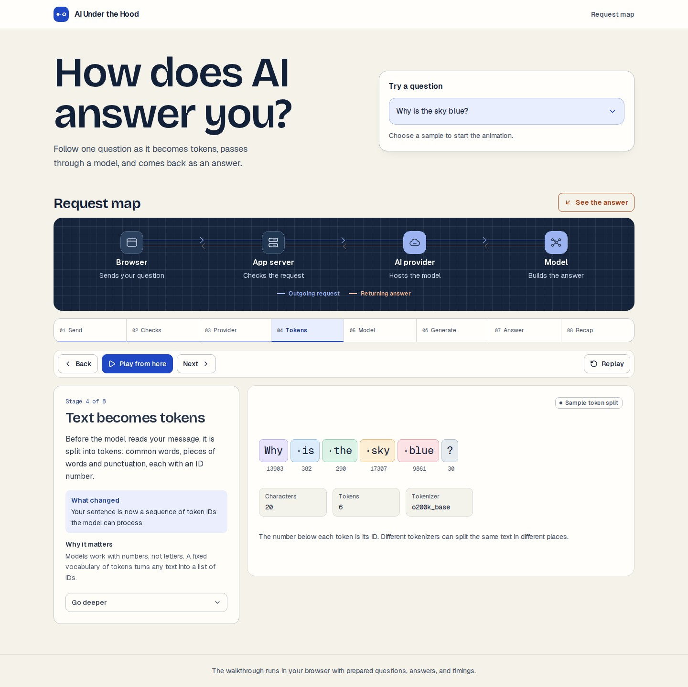

# AI Under the Hood

Choose a prepared question and follow a simulated AI request from your browser to a language model and back. Eight interactive stages show how a request is packaged, how text becomes tokens, and how an answer can stream back. Jump to any stage to inspect it at your own pace, or go straight to the sample answer. The lesson runs in the browser with prepared answers and timings.

[Open AI Under the Hood](https://ai-visualized.ericzwierzynski.dev)



## Run locally

Use Node.js 24 and pnpm.

```sh
cd web
pnpm install --frozen-lockfile
pnpm dev
```

Open [localhost:3000](http://localhost:3000).

See the [technical reference](docs/technical-reference.md) and [deployment guide](docs/DEPLOYMENT.md).
